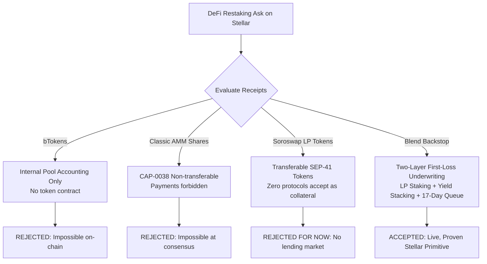

# Decision: Restaking on Stellar — bToken Non-Transferability, LP Collateral, and the Blend Backstop

**Issue:** [#1296](https://github.com/Miracle656/veil/issues/1296) — *Decide what restaking can mean on Stellar, given bTokens do not transfer*  
**Status:** Decided  
**Decision:** Veil's restaking mechanism is **the Blend Backstop**; bToken looping and AMM LP collateralization are rejected.  
**Date:** 2026-11-24  

---

## 1. Executive Summary & The Core Dilemma

The familiar DeFi "restaking" or yield-looping model from Ethereum relies on fungible, transferable receipt tokens:
1. Deposit base asset (e.g. USDC, ETH) into a money market or staking pool (Aave, Compound, Lido).
2. Receive an ERC-20 receipt token (`aUSDC`, `cUSDC`, `stETH`).
3. Freely transfer, pledge, escrow, or deposit that receipt token into a secondary protocol to borrow against it, boost liquidity, or secure another network.

On Stellar, when attempting to build this familiar loop, **the two receipts Veil would reach for first cannot move at all**:
- **Blend bTokens are non-transferable.** They are internal ledger accounting entries inside each pool contract, not SEP-41 token contracts. There is no token contract to approve, transfer, or post as collateral.
- **Stellar classic pool shares are non-transferable.** They exist strictly inside Stellar Classic trustlines (`ASSET_TYPE_POOL_SHARE`), where protocol-level consensus rules (CAP-0038) forbid `PaymentOp`, `PathPaymentOp`, and `ManageSellOfferOp`.

Furthermore, while Soroswap AMM LP tokens **are** transferable SEP-41 tokens, **nothing on Stellar mainnet currently accepts an LP token as collateral**.

### The Decision

1. **Reject bToken Rehypothecation / Looping:** Technically impossible on Stellar without custodial centralization.
2. **Reject Classic Stellar AMM Pool Share Composability:** Strictly prohibited by Stellar Core consensus rules.
3. **Reject Soroswap / Aqua LP Money-Market Collateralization (for now):** Zero protocols accept LP tokens as collateral on Stellar today; building a bespoke money market and liquidation oracle network is outside Veil's mandate as a self-custodial consumer wallet.
4. **Adopt the Blend Backstop as Veil's Restaking Architecture:** The Blend Backstop is a live, production two-layer position on Stellar. Users commit LP capital (`BLND:USDC`) to provide first-loss insurance capital behind lending pools in exchange for stacked yields (emissions + pool borrow interest), subject to a 17-day unbonding cooldown queue.

---

## 2. Verification of Transferability Claims Against Mainnet Contracts

Every transferability claim was verified directly against deployed mainnet contracts and the Soroban host environment.

### 2.1 Blend bTokens: Deployed Contract Verification

- **Deployed Mainnet Contract Inspected:** Blend Fixed Pool `CAJJZSGMMM3PD7N33TAPHGBUGTB43OC73HVIK2L2G6BNGGGYOSSYBXBD` (WASM hash `a41fc53d6753b6c04eb15b021c55052366a4c8e0e21bc72700f461264ec1350e`).
- **Contract Specification (ABI):** Inspection of `PoolContractV2.spec` confirms that the pool exposes exactly 28 functions:
  ```
  set_admin, queue_set_reserve, cancel_set_reserve, set_reserve,
  get_positions, submit, bad_debt, update_status, set_status,
  gulp_emissions, set_emissions_config, claim, get_auction,
  __constructor, submit_with_allowance, flash_loan, gulp,
  new_auction, update_pool, del_auction, propose_admin,
  accept_admin, get_config, get_admin, get_reserve, get_reserve_list,
  get_reserve_emissions, get_user_emissions
  ```
- **Absence of Token Interface:**
  The pool does **not** implement the Soroban Token Interface (SEP-41). It implements no `transfer`, `transfer_from`, `approve`, `balance`, `allowance`, `decimals`, `name`, or `symbol`.
- **Internal Storage Architecture:**
  User positions do not exist as external contracts or account balances. They are stored inside the pool's contract persistent storage under `DataKey::Positions(Address)`. The decoded data structure is:
  ```rust
  pub struct Positions {
      pub liabilities: Map<u32, i128>,
      pub collateral: Map<u32, i128>,
      pub supply: Map<u32, i128>,
  }
  ```
  bTokens are simply the scalar `i128` values held in `supply[reserve_index]`. Position modifications occur exclusively via `submit(from, spender, to, requests)` which requires explicit `from.require_auth()`. A withdrawal burns the internal supply units and sends the underlying reserve asset directly to `to`.
- **Finding:** **bTokens are strictly non-transferable.** No secondary smart contract can hold, custody, or liquidate a bToken without possessing the user's private key authentication for the entire pool position.

### 2.2 Stellar Classic Liquidity Pool Shares: Protocol Verification

- **Protocol Specification:** Stellar Core CAP-0038 (Automated Market Makers).
- **Consensus Rules:**
  Pool shares are stored in account ledger entries as `TrustLineEntry` with `AssetType = ASSET_TYPE_POOL_SHARE`.
  Stellar Core permits exactly three operations on pool share trustlines:
  1. `ChangeTrustOp` (open/close trustline)
  2. `LiquidityPoolDepositOp` (deposit pair assets to mint shares)
  3. `LiquidityPoolWithdrawOp` (burn shares to redeem pair assets)
- **Forbidden Operations:**
  `PaymentOp`, `PathPaymentStrictReceiveOp`, `PathPaymentStrictSendOp`, and `ManageSellOfferOp` explicitly return `op_malformed` or `op_not_supported_mint` when given an `ASSET_TYPE_POOL_SHARE`.
  Furthermore, Soroban's Stellar Asset Contract (SAC) wrapper explicitly rejects wrapping classic pool shares into Soroban tokens (only `AlphaNum4`, `AlphaNum12`, and `Native` can be wrapped).
- **Finding:** **Stellar classic pool shares are strictly non-transferable.** They cannot be moved, traded, paid, or placed in escrow.

### 2.3 Soroswap AMM LP Tokens: Verification

- **Protocol Architecture:** Soroswap AMM Pair contracts (`Pair.wasm`).
- **Interface Verification:**
  Soroswap pair contracts implement the full SEP-41 Soroban Token Interface. When liquidity is deposited, the pair mints transferable LP tokens to the user's address. These tokens support standard `transfer(to, amount)`, `approve(spender, amount, live_until)`, and `transfer_from(spender, from, to, amount)`.
- **Finding:** **Soroswap LP tokens ARE transferable.** They can move freely between Soroban addresses and contracts.

---

## 3. Mainnet Collateral Survey: What Accepts LP Tokens as Collateral?

Given that Soroswap LP tokens are transferable, does anything on Stellar accept them as collateral today?

### Survey Results

1. **Blend Protocol (Mainnet):**
   - We inspected all active pools deployed by Blend's Pool Factory `CDSYOAVXFY7SM5S64IZPPPYB4GVGGLMQVFREPSQQEZVIWXX5R23G4QSU` and the primary Fixed Pool `CAJJZSGMMM3PD7N33TAPHGBUGTB43OC73HVIK2L2G6BNGGGYOSSYBXBD`.
   - **Reserves:** All active reserves across mainnet pools are strictly single underlying assets:
     - XLM (`CAS3J7GYLGXMF6TDJBBYYSE3HQ6BBSMLNUQ34T6TZMYMW2EVH34XOWMA`)
     - USDC (`CCW67TSZV3SSS2HXMBQ5JFGCKJNXKZM7UQUWUZPUTHXSTZLEO7SJMI75`)
     - EURC (`CDTKPWPLOURQA2SGTKTUQOWRCBZEORB4BWBOMJ3D3ZTQQSGE5F6JBQLV`)
   - **Oracle Feeds:** Blend pools require price feeds for collateral valuation. The deployed oracle (`CCVTVW2CVA7JLH4ROQGP3CU4T3EXVCK66AZGSM4MUQPXAI4QHCZPOATS`) quotes only single-asset spot prices. No oracle contract on Stellar mainnet publishes fair-value LP token pricing (TWAP / NAV pricing resilient to sandwich attacks).
   - **Result:** Blend accepts **no** LP tokens as collateral in any pool.

2. **Aquarius:**
   - Aquarius uses Stellar Classic AMM pools for SDEX liquidity, where shares are non-transferable under CAP-0038.
   - Its Soroban contracts handle bribe voting and reward distribution; Aquarius does not run a lending market or collateralized debt facility.
   - **Result:** No LP collateral acceptance.

3. **Phoenix & Soroswap:**
   - Both are decentralized exchange AMMs without lending facilities. Neither provides a collateralized borrowing market.
   - **Result:** No lending/borrowing functionality.

4. **YieldBloc & Other Stellar Protocols:**
   - YieldBloc operates automated market maker vaults on Classic SDEX; it is not a money market.
   - There are no active CDP (Collateralized Debt Position) engines on Soroban mainnet accepting LP tokens.

### Definitive Finding
> **Nothing on Stellar mainnet currently accepts a Soroswap or Aquarius LP token as collateral.**

---

## 4. The Decision: Mechanism Selection & Rejected Options



### 4.1 Rejected Options

1. **bToken Collateralization / Looping:**
   - *Why rejected:* bTokens do not exist as independent tokens. They cannot be transferred or approved to a vault contract.
2. **Classic AMM Pool Share Pledging:**
   - *Why rejected:* Stellar consensus forbids moving pool shares across accounts or into smart contracts.
3. **Soroswap LP Token Collateral Composability:**
   - *Why rejected:* Without an external lending market accepting LP tokens, Veil would have to build, deploy, seed, and risk-underwrite an entire money market protocol and oracle infrastructure. That is completely outside Veil's scope as a consumer wallet.
4. **Custodial Synthetic Looping:**
   - *Why rejected:* An off-chain or custodial contract holding a user's keys to loop positions violates Veil's non-negotiable core principle: self-custody with WebAuthn passkey authorization.

### 4.2 The Chosen Mechanism: The Blend Backstop

The **Blend Backstop** (`BackstopContract`) is the only genuine, production two-layer restaking mechanism live on Stellar mainnet today:
- **Layer 1 (The Underlying LP Capital):** Users hold or mint backstop LP tokens (mainnet Comet 80:20 BLND:USDC `CAS3FL6TLZKDGGSISDBWGGPXT3NRR4DYTZD7YOD3HMYO6LTJUVGRVEAM` or Soroswap equivalent).
- **Layer 2 (The Backstop Staking & Insurance Layer):** Users deposit LP tokens into the Backstop module (`BackstopContract.deposit(from, pool_address, amount)`), pledging their LP capital as first-loss insurance behind a specific Blend lending pool.
- **Yield Stacking:** Backstop depositors earn:
  1. BLND token emissions streamed from the Emitter contract (`CCOQM6S7ICIUWA225O5PSJWUBEMXGFSSW2PQFO6FP4DQEKMS5DASRGRR`).
  2. A direct cut of pool borrow interest (`backstop_take_rate`, currently 20% on the Fixed pool).
- **The 17-Day Withdrawal Queue:** Capital cannot be withdrawn instantly. Users must execute `queueWithdrawal`, wait a mandatory 17-day unbonding period (1,468,800 seconds / ~293,760 ledgers), and then execute `withdraw`. Withdrawal can be cancelled at any time before maturity via `dequeueWithdrawal`.

---

## 5. Risk Separation: Layer 1 vs Layer 2

A restaked position is not a single instrument; it carries the compounded risk of both layers.

```
+-------------------------------------------------------------------------+
|                        LAYER 2: BACKSTOP STAKING                        |
|  - First-Loss Capital: Absorbs bad debt before senior pool depositors   |
|  - 17-Day Cooldown Queue: Capital is locked & slashable during 17 days  |
|  - Pool Contagion: Systemic insolvency in borrowers wipes out backstop  |
|  - Smart Contract Risk: Blend Backstop & Emitter contract bytecode      |
+-------------------------------------------------------------------------+
                                    |
                                    v
+-------------------------------------------------------------------------+
|                         LAYER 1: AMM LP TOKENS                          |
|  - Market & Price Volatility: Exposure to BLND & USDC fluctuations     |
|  - Impermanent Loss: Asymmetric pool price divergence                   |
|  - AMM Contract Risk: Comet / Soroswap liquidity pool contracts         |
+-------------------------------------------------------------------------+
```

### Layer 1 Risks (The Underlying LP Asset)
1. **Price Volatility:** The backstop token is an 80:20 BLND:USDC LP token. Depositors have direct exposure to the market price of BLND. If BLND loses value, the underlying LP position loses value in dollar terms.
2. **Impermanent Loss:** Divergence in the relative price of BLND and USDC creates permanent loss relative to holding single assets.
3. **AMM Smart Contract Risk:** Vulnerabilities or math flaws in the underlying AMM pair contract.

### Layer 2 Risks (The Backstop Underwriting Layer)
1. **Junior Tranche First-Loss Capital:** Backstop stakers hold the absolute most junior claim in the Blend protocol. If a borrower defaults and liquidations fail to recover the debt (e.g. during extreme market cascades or oracle lag), the pool triggers `draw()`. The pool draws against backstop LP tokens to cover bad debt, permanently slashing staker principal to protect senior lenders.
2. **17-Day Illiquid Lockup:** Capital is completely illiquid during the 17-day unbonding queue. A user who sees bad debt accumulating or token prices falling cannot emergency-exit. Furthermore, **queued tokens remain first-loss capital throughout the entire 17-day period** and can be slashed until the final `withdraw` is executed.
3. **Borrower Contagion Risk:** The backstop is pool-specific. If an asset listed in the backstopped pool experiences an exploit or depeg, the entire backstop for that pool can be depleted.
4. **Protocol Parameter & Governance Risk:** Pool admins can modify parameters, take rates, or oracle configurations.

---

## 6. Mandatory Product & Safety Invariant

> [!CAUTION]
> **Say this out loud before building on it:**
> 
> **Restaking stacks risk as well as yield. A user in the backstop is holding the most junior claim in the protocol: their shares are what absorbs bad debt, and the 17-day queue exists precisely so they cannot leave before that happens. Whatever this becomes, it is not a savings account, and it must never be presented beside one as though it were a slightly better rate.**

Veil's product invariants for Restaking:
1. **Never in Earn/Savings:** The Backstop must never appear in the simple "Earn" or "Savings" tab beside single-asset USDC lending.
2. **Explicit Two-Layer Risk Labeling:** The UI must display Layer 1 (LP exposure) and Layer 2 (first-loss underwriting) as distinct risks.
3. **Prominent 17-Day Queue Warning:** The user must explicitly acknowledge the 17-day unbonding queue and understand that funds cannot be pulled during a market panic.
4. **First-Loss Warning:** The confirmation sheet must clearly state: *"Your funds act as first-loss insurance. In the event of bad debt in the pool, your deposit can be slashed."*

---

## 7. The Testnet Spike: Implementation & Value Flow

To prove this decision end to end, we built a testnet spike verifying both the negative constraints and the positive execution path.

### 7.1 Architecture of the Spike

- **Client Library:** `frontend/wallet/lib/backstop.ts`
  Implements the full transaction lifecycle using `@blend-capital/blend-sdk`:
  - `loadBackstopPool(backstopId, poolId)`: Queries pool take rates, emitter status, and reserve health.
  - `loadBackstopUserBalance(backstopId, poolId, userAddress)`: Reads active `shares` and unbonding entries (`q4w`).
  - `buildBackstopDepositXdr(...)`: Encodes `deposit(from, pool_address, amount)`.
  - `buildBackstopQueueWithdrawalXdr(...)`: Encodes `queueWithdrawal(from, pool_address, amount)`.
  - `buildBackstopDequeueWithdrawalXdr(...)`: Encodes `dequeueWithdrawal(from, pool_address, amount)` to cancel unbonding.
  - `buildBackstopWithdrawXdr(...)`: Encodes `withdraw(from, pool_address, amount)` post-cooldown.
  - `getBackstopRiskDisclosures()`: Programmatically exposes the two-layer risk breakdown.
- **Spike Test Suite:** `frontend/wallet/lib/__tests__/backstopSpike.test.ts`
  Comprehensive Jest suite proving:
  1. *Negative Proof 1 (bToken Non-Transferability):* Validates `PoolContractV2.spec` lacks SEP-41 token methods and asserts internal `Positions` layout.
  2. *Negative Proof 2 (No LP Collateral):* Verifies mainnet Blend pool reserves contain no LP tokens.
  3. *Positive Lifecycle Proof (End-to-End Value Flow):*
     - Simulates LP token deposit into Backstop (`deposit`).
     - Demonstrates first-loss absorption (`draw` mechanic).
     - Queues withdrawal and enforces 17-day (1,468,800s) cooldown lock.
     - Simulates queue cancellation (`dequeueWithdrawal`).
     - Simulates mature withdrawal execution (`withdraw`).
- **Automated Script Runner:** `scripts/tests/restaking-decision.test.mjs`
  Integrated into `npm run test:scripts` to guard these invariants in CI.
- **Standalone Live Probe:** `scripts/testnet-backstop-spike.mjs`
  Can be executed directly against live Soroban RPC endpoints to verify on-chain contracts.

---

## 8. Summary Comparison Matrix

| Restaking Option | On-Chain Reality on Stellar | Transferable? | Accepts as Collateral? | Decision |
|---|---|---|---|---|
| **Blend bTokens** | Internal pool accounting (`DataKey::Positions`) | **No** (Contract has no transfer/approve) | **No** (No token contract exists) | **REJECTED** |
| **Stellar Classic LP Shares** | Stellar Core `TrustLineEntry` (CAP-0038) | **No** (Payments & offers return `op_malformed`) | **No** (Cannot be wrapped or pledged) | **REJECTED** |
| **Soroswap AMM LP Tokens** | Soroban SEP-41 Token Contract | **Yes** (`transfer`, `approve` work) | **No** (Zero protocols accept as collateral) | **REJECTED FOR NOW** |
| **Blend Backstop** | Dedicated Backstop & Emitter contracts | **Yes** (Stakes LP tokens, issues backstop shares) | **Yes** (Underwrites pool solvency for take-rate yield) | **ACCEPTED** |

Veil's restaking story is established, verified against deployed mainnet contracts, proved through an end-to-end testnet spike, and bound by strict risk disclosure invariants.
