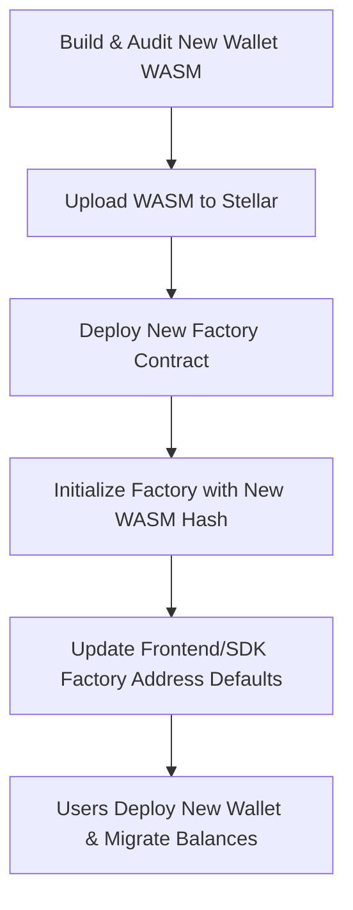

import { Callout } from 'nextra/components'

# Contract Immutability & Upgrades

A foundational property of Veil's on-chain architecture is **contract immutability**: once deployed on Stellar, contracts cannot be upgraded in place.

<Callout type="warning">
  **No existing wallet can be upgraded, by anyone.** No wallet contract, deployed or in source, has an upgrade entrypoint (`update_current_contract_wasm` or an `upgrade` function). The factory deployed on mainnet has no way to change its wallet code either. Every deployed wallet runs the exact bytecode it was deployed with, permanently. Neither its owner, the factory admin, nor Veil can change it.
</Callout>

There is one nuance, and this page keeps the two sides of it apart:

- **Deployed on mainnet (permanent).** The mainnet factory was built from commit `ccebd01a9b71c9857e6cd1e05dbdf6d45ea38ba2` (see `contracts/deployments.json`). It has **three entrypoints** and can never gain a fourth. The wallet WASM hash it deploys can never change.
- **Source on `main` (not deployed).** The factory source now has a fourth entrypoint, an admin-gated `set_wasm_hash` (added in commit `d93abe5cb66391d0aa4435bb1207a13444ae86c5` for #1171). A **new** factory deployed from this source could point the wallets it deploys **afterwards** at new code. It still could not change any wallet that already exists.

This page explains how the contracts are structured, what immutability means for existing wallet holders, and the procedure required when new contract versions are released.

---

## The Reality: Immutability by Design

While the Soroban environment provides host primitives for in-place contract replacement (`env.deployer().update_current_contract_wasm`), Veil contracts deliberately do **not** implement or expose upgrade functions.

### Documented Assumptions vs. Actual Implementation

| Component | Purported Mechanism | Reality in Code |
|---|---|---|
| **Factory Contract (mainnet)** | `set_wasm_hash` entrypoint | ❌ **Not in the deployed factory.** The mainnet factory, built from `ccebd01a9b71c9857e6cd1e05dbdf6d45ea38ba2`, has only `__constructor`, `init` and `deploy`. Its wallet WASM hash is set once by `init()` and can never change. |
| **Factory Contract (source on `main`)** | `set_wasm_hash` entrypoint | ⚠️ **Written, not deployed.** `contracts/factory/src/lib.rs` has an admin-gated `set_wasm_hash(new_hash)`. It changes which code **future** `deploy` calls install, and only in a factory deployed from this source. It never touches an existing wallet. |
| **Invisible Wallet** | `upgrade(new_wasm_hash)` via `update_current_contract_wasm` | ❌ **Does not exist.** Neither `update_current_contract_wasm` nor any `upgrade` entrypoint is present in `contracts/invisible_wallet/`. Deployed wallets run their initial code permanently. |

### Why Immutability?

Immutability provides strong security guarantees for self-custody:
- **No operator backdoors:** No admin, operator, or deployer key has the power to unilaterally overwrite the bytecode of your wallet or drain funds.
- **Deterministic verification:** The on-chain code matching a given contract address is static and reproducible from source. What was audited and deployed remains what executes.
- **No surprise logic shifts:** Transaction authorization, spend caps, and signature validation logic cannot change out from under the wallet owner.

The trade-off is that fixes, optimizations, and new features cannot be silently or automatically pushed to existing wallets.

---

## Real Contract Entrypoints

Understanding what the contracts actually expose clarifies how deployments and management work.

### 1. Factory Contract (`contracts/factory/src/lib.rs`)

#### Deployed on mainnet: three entrypoints, permanent

The mainnet factory (`CCZ3JLRESNLDADGXWNEH4YQ4NXUUAHRJNCWZHYG6QB4KTDYHOH6OQ7BK`) was built from commit `ccebd01a9b71c9857e6cd1e05dbdf6d45ea38ba2`. It exposes **exactly three entrypoints**, and because it has no upgrade path it will never have more:

```rust
// git show ccebd01a9b71c9857e6cd1e05dbdf6d45ea38ba2:contracts/factory/src/lib.rs

pub fn __constructor(env: Env, admin: Address)
pub fn init(env: Env, wasm_hash: BytesN<32>) -> Result<(), FactoryError>
pub fn deploy(
    env: Env,
    public_key: BytesN<65>,
    rp_id: Bytes,
    origin: Bytes,
) -> Result<Address, FactoryError>
```

| Entrypoint | Access | Description |
|---|---|---|
| `__constructor` | Deployer | Runs atomically during contract creation to bind the factory admin address so it cannot be front-run. |
| `init` | Admin only | One-time initialization. Stores the wallet WASM hash (`storage::set_wasm_hash`). Calling it a second time returns `Err(FactoryError::AlreadyInitialized)`. |
| `deploy` | Public | Deploys a new wallet using salt `SHA-256(public_key)` and the stored WASM hash, then invokes `init` on the wallet. Calling it again with the same public key returns `Err(FactoryError::AlreadyDeployed)`. |

In the deployed factory the stored WASM hash is written only by `init()`, so the wallet code it deploys (WASM SHA-256 `b485f817469402ba4ccc24ea30077308f69589cbe0897db49087b15f58659ea5`) is fixed forever.

#### Source on `main`: a fourth entrypoint, not deployed

The factory source on `main` adds `set_wasm_hash`:

```rust
// contracts/factory/src/lib.rs (main), not deployed
pub fn set_wasm_hash(env: Env, new_hash: BytesN<32>) -> Result<(), FactoryError>
```

| Entrypoint | Access | Description |
|---|---|---|
| `set_wasm_hash` | Admin only | Points **future** `deploy` calls at a new wallet WASM hash. Only the admin fixed by `__constructor` can call it, the same gate as `init`. It refuses to run before `init` has stored a first hash, returning `Err(FactoryError::NotInitialized)`, so `init` stays the one place the first hash is installed. |

What `set_wasm_hash` deliberately does **not** do, per its doc comment:

- **It never touches an existing wallet.** `deploy` reads the hash when it is called, and a deployed wallet's code is pinned by its own contract instance. The factory holds no pointer back to the wallets it deployed.
- **It does not change any wallet address.** A wallet's address derives from the factory address and the salt (`SHA-256(public_key)`), never from the WASM hash. An address computed before the call is the address `deploy` still produces after it.

<Callout type="warning">
  `set_wasm_hash` exists only in source. It is **not** in the mainnet factory and cannot be added to it. It would only take effect in a new factory, deployed from this source at a new address. Even there it changes only the wallets deployed after the call. Wallets that already exist keep their code forever.
</Callout>

### 2. Invisible Wallet Contract (`contracts/invisible_wallet/src/lib.rs`)

The wallet contract exposes 29 entrypoints in source on `main`. 24 of them are in the wallets deployed on mainnet. The five marked *(source only)* below exist only in source and are not in any mainnet wallet:

- **Initialization & Auth:** `init`, `__check_auth`
- **Signer Management:** `add_signer`, `remove_signer`, `rotate_signer`, `has_signer`, `get_signers`, `get_nonce`
- **Execution & Allowances:** `execute`, `approve`, `revoke_allowance` *(source only)*, `get_allowance`
- **Guardian Recovery:** `set_guardian`, `initiate_recovery`, `complete_recovery`, `cancel_recovery`, `get_pending_recovery` *(source only)*
- **Recovery Key:** `set_recovery_key`, `request_recovery`, `finalize_recovery`, `cancel_recovery_request`
- **Session Keys:** `register_session_key`, `register_session_key_scoped` *(source only)*, `revoke_session_key`
- **Spend Limits:** `set_key_spend_limit`, `remove_key_spend_limit`, `remove_all_key_spend_limits` *(source only)*, `get_key_spend_limit`, `get_key_spend_limit_tokens` *(source only)*

See the [Contract API](/contract-api) for signatures.

**There is no `upgrade` entrypoint, in the deployed wallet or in source.** A wallet's bytecode cannot be modified after deployment. A source-only function will never appear in a wallet that is already deployed.

---

## What This Means for Existing Wallet Holders

For an existing wallet holder on Stellar mainnet:

1. **Permanent Code Execution:**
   The mainnet factory (`CCZ3JLRESNLDADGXWNEH4YQ4NXUUAHRJNCWZHYG6QB4KTDYHOH6OQ7BK`) and every wallet deployed from it run the exact code they were initialized with (wallet WASM SHA-256 `b485f817469402ba4ccc24ea30077308f69589cbe0897db49087b15f58659ea5`). The mainnet factory has no `set_wasm_hash`, so this cannot change.
2. **Fixes Do Not Reach Existing Wallets:**
   If a bug fix or new feature is introduced to the wallet contract, existing deployed wallets **will not receive the update**. They continue running their existing bytecode.
3. **New Factory for New Releases:**
   To deploy wallets with updated contract code, a **new factory contract at a new contract address** must be deployed on-chain and initialized with the new wallet WASM hash. If that new factory is built from current source, it will have `set_wasm_hash`, so *later* releases could reuse it instead of needing yet another factory. That still never changes a wallet that already exists.
4. **New Factory Means New Wallet Addresses:**
   Soroban contract addresses for deterministic deployments are derived from:
   ```
   HashIdPreimage::ContractId { networkId, factoryAddress, salt }
   ```
   Because the factory address is part of the wallet's contract ID preimage, deploying from a new factory produces a **different wallet address** for the user's passkey.
5. **Migration is Opt-In Fund Transfer:**
   To upgrade to a new contract version, a wallet holder must:
   - Deploy a new wallet instance through the new factory.
   - Transfer (migrate) their tokens and assets from the old wallet address to the new wallet address.
   - The old wallet remains active and unchanged on-chain under its original code.

---

## Shipping Updates: The Migration Workflow

Because contracts cannot be patched in place, releasing updates follows a multi-step deployment and migration flow:



### 1. Build and Upload New WASM

```bash
cd contracts/invisible_wallet
cargo build --target wasm32-unknown-unknown --release

NEW_WASM_HASH=$(stellar contract upload \
  --wasm target/wasm32-unknown-unknown/release/invisible_wallet.wasm \
  --source <DEPLOYER_SECRET> \
  --rpc-url https://soroban-rpc.mainnet.stellar.org \
  --network-passphrase "Public Global Stellar Network ; September 2015")
```

### 2. Deploy and Initialize a New Factory

```bash
# 1. Deploy new factory WASM
FACTORY_WASM_HASH=$(stellar contract upload \
  --wasm target/wasm32-unknown-unknown/release/factory.wasm \
  --source <DEPLOYER_SECRET> \
  --rpc-url https://soroban-rpc.mainnet.stellar.org \
  --network-passphrase "Public Global Stellar Network ; September 2015")

# 2. Instantiate factory contract (sets constructor admin)
NEW_FACTORY_ID=$(stellar contract deploy \
  --wasm-hash $FACTORY_WASM_HASH \
  --source <DEPLOYER_SECRET> \
  --rpc-url https://soroban-rpc.mainnet.stellar.org \
  --network-passphrase "Public Global Stellar Network ; September 2015" \
  -- \
  --admin <ADMIN_ADDRESS>)

# 3. Initialize factory with the new wallet WASM hash
stellar contract invoke \
  --id $NEW_FACTORY_ID \
  --source <ADMIN_SECRET> \
  --rpc-url https://soroban-rpc.mainnet.stellar.org \
  --network-passphrase "Public Global Stellar Network ; September 2015" \
  --fn init \
  -- \
  --wasm_hash $NEW_WASM_HASH
```

### 3. Client Migration

Once the new factory is initialized:
1. Update `NEXT_PUBLIC_FACTORY_CONTRACT_ID` in `frontend/wallet` and default factory IDs in the SDK.
2. The client application recognizes when a user's passkey holds a wallet on the prior factory.
3. The application guides the user through creating their new wallet and submitting a transfer transaction to migrate their funds from the old address to the new address.

---

## Future Roadmap: Contracts v2 (Planned)

A future evolution of Veil contracts (tracked in `docs/CONTRACTS_V2.md`) explores self-custodial upgradeability while maintaining security:

- **Self-Custodial Wallet Upgrades:** If an `upgrade(new_wasm_hash)` entrypoint is introduced to the wallet contract, it will **only** be authorized by that wallet's registered signers (via WebAuthn `__check_auth`). **Never by an operator key.**
- **Factory Hash Update:** *Written, not deployed.* The factory source on `main` now has an admin-gated `set_wasm_hash(new_hash)`, so once a factory built from it is deployed, later wallet deployments can receive updated code without changing that factory's address. It does not alter already-deployed wallets or any wallet address, and it does not exist in the mainnet factory.
- **Account Abstraction Standard:** Evaluating standard smart account frameworks (e.g. OpenZeppelin Soroban smart accounts) to provide standardized upgrade and migration patterns.

Until Contracts v2 is formally implemented, tested, and deployed, **all deployed Veil contracts remain strictly immutable**. Even after that, no wallet that already exists today can be upgraded. Its owner can only move funds to a new wallet.

---

## Related

- [Architecture](/architecture) — Two-account model and WebAuthn pipeline
- [Contract API](/contract-api) — Reference for all contract functions and entrypoints
- [Security Model](/security) — Security guarantees and threat analysis
- [Network Guide](/guides/networks) — Multi-network configuration and factory addresses
