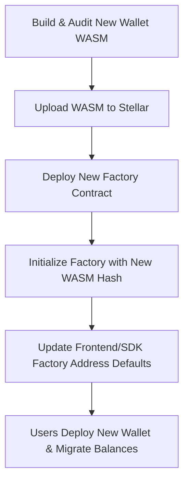

import { Callout } from 'nextra/components'

# Contract Immutability & Upgrades

A foundational property of Veil's on-chain architecture is **contract immutability**: once deployed on Stellar, contracts cannot be upgraded in place.

<Callout type="warning">
  **No in-place upgrades exist:** Neither the factory contract nor individual wallet contracts expose an upgrade entrypoint (`update_current_contract_wasm` or `set_wasm_hash`). Deployed contracts run the exact bytecode they were deployed with permanently.
</Callout>

This page explains how the contracts are structured, what immutability means for existing wallet holders, and the procedure required when new contract versions are released.

---

## The Reality: Immutability by Design

While the Soroban environment provides host primitives for in-place contract replacement (`env.deployer().update_current_contract_wasm`), Veil contracts deliberately do **not** implement or expose upgrade functions.

### Documented Assumptions vs. Actual Implementation

| Component | Purported Mechanism | Reality in Code |
|---|---|---|
| **Factory Contract** | `set_wasm_hash` (public entrypoint) | ❌ **Does not exist.** `set_wasm_hash` is an internal storage helper in `contracts/factory/src/storage.rs`, called once by `init()`. The WASM hash cannot be changed after initialization. |
| **Invisible Wallet** | `upgrade(new_wasm_hash)` via `update_current_contract_wasm` | ❌ **Does not exist.** Neither `update_current_contract_wasm` nor any `upgrade` entrypoint is present in `contracts/invisible_wallet/`. Deployed wallets run their initial code permanently. |

### Why Immutability?

Immutability provides strong security guarantees for self-custody:
- **No operator backdoors:** No admin, operator, or deployer key has the power to unilaterally overwrite the bytecode of your wallet or drain funds.
- **Deterministic verification:** The on-chain code matching a given contract address is static and reproducible from source. What was audited and deployed remains what executes.
- **No surprise logic shifts:** Transaction authorization, spend caps, and signature validation logic cannot change out from under the wallet owner.

The trade-off is that fixes, optimizations, and new features cannot be silently or automatically pushed to existing wallets.

---

## Real Contract Entrypoints

Understanding what the contracts actually expose clarifies how deployments and management work.

### 1. Factory Contract (`contracts/factory/src/lib.rs`)

The factory exposes **exactly three entrypoints**:

```rust
// contracts/factory/src/lib.rs

pub fn __constructor(env: Env, admin: Address)
pub fn init(env: Env, wasm_hash: BytesN<32>) -> Result<(), FactoryError>
pub fn deploy(
    env: Env,
    public_key: BytesN<65>,
    rp_id: Bytes,
    origin: Bytes,
) -> Result<Address, FactoryError>
```

| Entrypoint | Access | Description |
|---|---|---|
| `__constructor` | Deployer | Runs atomically during contract creation to bind the factory admin address so it cannot be front-run. |
| `init` | Admin only | One-time initialization. Stores the wallet WASM hash (`storage::set_wasm_hash`). Calling it a second time returns `Err(FactoryError::AlreadyInitialized)`. |
| `deploy` | Public | Deploys a new wallet using salt `SHA-256(public_key)` and the immutable stored WASM hash, then invokes `init` on the wallet. Calling it again with the same public key returns `Err(FactoryError::AlreadyDeployed)`. |

<Callout type="info">
  `storage::set_wasm_hash` is an internal storage helper in `storage.rs`. It is called only by `init()` during setup. There is no public or admin entrypoint to update the WASM hash after the factory is initialized.
</Callout>

### 2. Invisible Wallet Contract (`contracts/invisible_wallet/src/lib.rs`)

The wallet contract exposes entrypoints for authentication, signer management, execution, allowances, and guardian recovery:

- **Initialization & Auth:** `init`, `__check_auth`
- **Signer Management:** `add_signer`, `remove_signer`, `rotate_signer`, `has_signer`, `get_signers`, `get_nonce`
- **Execution & Allowances:** `execute`, `approve`, `get_allowance`
- **Guardian Recovery:** `set_guardian`, `initiate_recovery`, `complete_recovery`

**There is no `upgrade` entrypoint.** The contract bytecode cannot be modified after deployment.

---

## What This Means for Existing Wallet Holders

For an existing wallet holder on Stellar mainnet:

1. **Permanent Code Execution:**
   The mainnet factory (`CCZ3JLRESNLDADGXWNEH4YQ4NXUUAHRJNCWZHYG6QB4KTDYHOH6OQ7BK`) and every wallet deployed from it run the exact code they were initialized with (`b485f817…`).
2. **Fixes Do Not Reach Existing Wallets:**
   If a bug fix or new feature is introduced to the wallet contract, existing deployed wallets **will not receive the update**. They continue running their existing bytecode.
3. **New Factory for New Releases:**
   To deploy wallets with updated contract code, a **new factory contract at a new contract address** must be deployed on-chain and initialized with the new wallet WASM hash.
4. **New Factory Means New Wallet Addresses:**
   Soroban contract addresses for deterministic deployments are derived from:
   ```
   HashIdPreimage::ContractId { networkId, factoryAddress, salt }
   ```
   Because the factory address is part of the wallet's contract ID preimage, deploying from a new factory produces a **different wallet address** for the user's passkey.
5. **Migration is Opt-In Fund Transfer:**
   To upgrade to a new contract version, a wallet holder must:
   - Deploy a new wallet instance through the new factory.
   - Transfer (migrate) their tokens and assets from the old wallet address to the new wallet address.
   - The old wallet remains active and unchanged on-chain under its original code.

---

## Shipping Updates: The Migration Workflow

Because contracts cannot be patched in place, releasing updates follows a multi-step deployment and migration flow:



### 1. Build and Upload New WASM

```bash
cd contracts/invisible_wallet
cargo build --target wasm32-unknown-unknown --release

NEW_WASM_HASH=$(stellar contract upload \
  --wasm target/wasm32-unknown-unknown/release/invisible_wallet.wasm \
  --source <DEPLOYER_SECRET> \
  --rpc-url https://soroban-rpc.mainnet.stellar.org \
  --network-passphrase "Public Global Stellar Network ; September 2015")
```

### 2. Deploy and Initialize a New Factory

```bash
# 1. Deploy new factory WASM
FACTORY_WASM_HASH=$(stellar contract upload \
  --wasm target/wasm32-unknown-unknown/release/factory.wasm \
  --source <DEPLOYER_SECRET> \
  --rpc-url https://soroban-rpc.mainnet.stellar.org \
  --network-passphrase "Public Global Stellar Network ; September 2015")

# 2. Instantiate factory contract (sets constructor admin)
NEW_FACTORY_ID=$(stellar contract deploy \
  --wasm-hash $FACTORY_WASM_HASH \
  --source <DEPLOYER_SECRET> \
  --rpc-url https://soroban-rpc.mainnet.stellar.org \
  --network-passphrase "Public Global Stellar Network ; September 2015" \
  -- \
  --admin <ADMIN_ADDRESS>)

# 3. Initialize factory with the new wallet WASM hash
stellar contract invoke \
  --id $NEW_FACTORY_ID \
  --source <ADMIN_SECRET> \
  --rpc-url https://soroban-rpc.mainnet.stellar.org \
  --network-passphrase "Public Global Stellar Network ; September 2015" \
  --fn init \
  -- \
  --wasm_hash $NEW_WASM_HASH
```

### 3. Client Migration

Once the new factory is initialized:
1. Update `NEXT_PUBLIC_FACTORY_CONTRACT_ID` in `frontend/wallet` and default factory IDs in the SDK.
2. The client application recognizes when a user's passkey holds a wallet on the prior factory.
3. The application guides the user through creating their new wallet and submitting a transfer transaction to migrate their funds from the old address to the new address.

---

## Future Roadmap: Contracts v2 (Planned)

A future evolution of Veil contracts (tracked in `docs/CONTRACTS_V2.md`) explores self-custodial upgradeability while maintaining security:

- **Self-Custodial Wallet Upgrades:** If an `upgrade(new_wasm_hash)` entrypoint is introduced to the wallet contract, it will **only** be authorized by that wallet's registered signers (via WebAuthn `__check_auth`). **Never by an operator key.**
- **Factory Hash Update:** A future factory might provide an admin-gated `set_wasm_hash(new_hash)` so new wallet deployments receive updated code without changing the factory address. This would still not alter already-deployed wallets.
- **Account Abstraction Standard:** Evaluating standard smart account frameworks (e.g. OpenZeppelin Soroban smart accounts) to provide standardized upgrade and migration patterns.

Until Contracts v2 is formally implemented, tested, and deployed, **all deployed Veil contracts remain strictly immutable**.

---

## Related

- [Architecture](/architecture) — Two-account model and WebAuthn pipeline
- [Contract API](/contract-api) — Reference for all contract functions and entrypoints
- [Security Model](/security) — Security guarantees and threat analysis
- [Network Guide](/guides/networks) — Multi-network configuration and factory addresses
